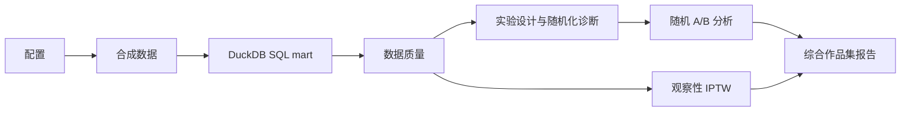

# Growth Experiment Lab

## 一句话介绍

一个基于**合成用户数据**的个人开源作品集：使用 Python、SQL 与 DuckDB，完整演示随机
A/B 实验和观察性因果效果评估，并提供可复现流水线、自动报告、测试与持续集成。

## Important Disclaimer

- 这不是公司项目，也不是生产实验平台。
- 数据、指标和运行结果全部来自固定随机种子的合成数据，不代表真实用户效果。
- 报告提供结构化决策支持，但不能自动决定上线或停止，必须人工复核。
- 合成真值只用于隔离的方法验证，不进入正式分析报告。

## What This Project Demonstrates

- DuckDB SQL 用户级分析底表与严格数据质量契约
- 样本量、MDE、SRM、处理前 SMD 与 A/A 模拟
- 二元指标、Welch 检验、Bootstrap、Holm 校正与护栏阈值
- CUPED、预定义 `is_new_user` 分群与 HC3 交互检验
- 倾向得分、stabilized IPTW、overlap、ESS 与 Love plot
- Markdown 自动报告、pytest、ruff 与 GitHub Actions

## Architecture



## Quick Start

要求 Python 3.11。项目只声明直接依赖，不提交环境级 `pip freeze` 或 lock file；CI 会在
干净环境中重新安装并验证。

通用命令：

```bash
python -m pip install -e ".[dev]"
python -m growth_experiment_lab run-all --config configs/demo.toml
```

Windows PowerShell：

```powershell
python -m pip install -e ".[dev]"
python -m growth_experiment_lab run-all --config configs/demo.toml
```

如本地已有生成产物，可显式使用 `--overwrite`。快速 demo 与完整 default 使用不同固定
种子和规模，数值不同是正常现象；demo 结果不能作为生产结论。

已提交的真实生成示例见 [examples/portfolio_report.md](examples/portfolio_report.md)。重新生成：

```bash
python -m growth_experiment_lab run-all --config configs/demo.toml --overwrite
python -m growth_experiment_lab export-examples --config configs/demo.toml --overwrite
```

## Main Outputs

- `reports/generated/portfolio_report.md`：综合正式报告
- `reports/generated/ab_analysis.md`：随机实验报告
- `reports/generated/observational_analysis.md`：观察性 IPTW 报告
- `reports/generated/*.json`：结构化结果与独立验证产物
- `reports/generated/*.png`：随机化、效果、overlap、权重和平衡图

完整生成目录被 Git 忽略；`examples/` 只提交 demo 配置生成的轻量正式报告和图表，不包含
数据或真值验证输出。

## Statistical Methods

- 指标定义：[docs/metric_definitions.md](docs/metric_definitions.md)
- 实验设计与随机化：[docs/experiment_design.md](docs/experiment_design.md)、[docs/randomization_diagnostics.md](docs/randomization_diagnostics.md)
- 随机实验估计：[docs/ab_effect_estimation.md](docs/ab_effect_estimation.md)
- Bootstrap 与 CUPED：[docs/bootstrap.md](docs/bootstrap.md)、[docs/cuped.md](docs/cuped.md)
- 倾向得分与 IPTW：[docs/propensity_score.md](docs/propensity_score.md)、[docs/iptw.md](docs/iptw.md)
- 方法总览：[docs/methodology.md](docs/methodology.md)

核心契约：主指标为 `next_day_retention`；`clicked` 表示实验期内至少点击一次；
`watch_time_minutes` 包含零观看用户；`negative_feedback` 为护栏。实验单位为 `user_id`，
随机实验按首次分组执行 ITT。IPTW 主分析使用未截断稳定化权重，1%/99% 截断仅为敏感性分析。

## Repository Structure

```text
configs/   default、demo 与 CI 配置
docs/      方法、局限与求职展示材料
examples/  demo 配置生成的轻量公开示例
sql/       DuckDB 用户级 mart SQL
src/       可安装的 growth_experiment_lab 包
tests/     单元、CLI 与流水线测试
```

## Testing

```bash
python -m pytest -q
python -m ruff check .
python -m growth_experiment_lab run-all --config configs/ci.toml --overwrite
```

GitHub Actions 在 Ubuntu 和 Python 3.11 上执行相同检查，不需要 secret 或外部私有数据。

## Limitations

详见 [docs/limitations.md](docs/limitations.md)。随机实验推断仍依赖实施与测量质量；IPTW
无法解决未观测混杂；合成数据结论不能外推到真实产品。

## Portfolio Notes

本项目是作为数据分析、数据科学、A/B 实验、因果分析和数据产品方向的个人作品，重点
展示统计口径、可复现性、数据契约和工程验证能力，不代表真实线上实验或生产平台经验。

## License

MIT License，详见 [LICENSE](LICENSE)。
