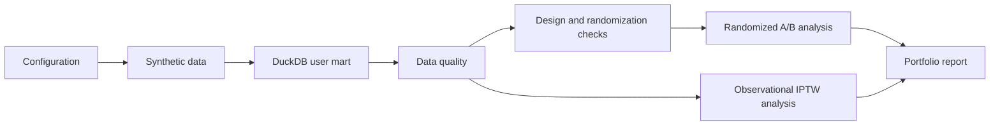

> Generated from synthetic data with `configs/demo.toml`.

# Growth Experiment Lab — Portfolio Report

> Generated from synthetic data. This is a personal open-source portfolio project,
> not a company project or production experiment platform.
> Generated with `configs/demo.toml`.

`requires_human_review = true`

## Project scope

Reproducible user-growth experiment design, randomized A/B evaluation, and
observational stabilized-IPTW evaluation using Python, SQL, and DuckDB.

## Analysis flow



## Data contract and quality

- Quality checks passed: True
- Randomized users: 25000
- Observational users: 25000
- Experimental unit: `user_id`; randomized analysis uses first-assignment ITT.

## Experiment design

- Primary metric: `next_day_retention`
- Planned sample size: 66548
- Planned absolute MDE: 0.0100
- Current-mart detectable absolute effect: 0.0164

## Randomization quality

- SRM passed: True
- Maximum pre-treatment |SMD|: 0.0138
- A/A empirical false-positive rate: 0.0200 (2/100)

## Randomized A/B experiment

| Metric | Role | Absolute effect | 95% CI | p-value |
|---|---|---:|---:|---:|
| next_day_retention | primary | 0.0091 | [-0.0024, 0.0205] | 0.1206 |
| clicked | secondary | 0.0169 | [0.0069, 0.0270] | 0.0009519 |
| watch_time_minutes | secondary | 0.3629 | [-0.1754, 0.9013] | 0.1864 |
| negative_feedback | guardrail | 0.0033 | [-0.0018, 0.0083] | 0.2029 |

- Guardrail status: `inconclusive`
- CUPED variance reduction: 2.8916783930339474
- The only predefined subgroup is `is_new_user`; interaction tests use HC3.

## Observational causal analysis

| Metric | Naive difference | Untrimmed stabilized IPTW ATE | Trimmed sensitivity |
|---|---:|---:|---:|
| next_day_retention | 0.0808 | 0.0184 | 0.0231 |
| clicked | 0.0739 | 0.0122 | 0.0172 |
| watch_time_minutes | 4.2418 | 0.8593 | 1.2742 |
| negative_feedback | -0.0128 | 0.0038 | 0.0034 |

- Propensity range: 0.0758 to 0.9783
- Overall ESS: 20083.8
- Maximum |SMD| before / after IPTW: 0.7374 / 0.0108

## Boundaries, risks, and open questions

- All data and results are synthetic and cannot be generalized to real users.
- IPTW adjusts measured covariates only and cannot remove unmeasured confounding.
- Statistical significance does not replace effect size, guardrail, or domain review.
- Independent synthetic validation exists but is not read by this formal report.
- No automated launch decision is made; human review is required.

## Reproduce

```bash
python -m growth_experiment_lab run-all --config configs/demo.toml --overwrite
```
